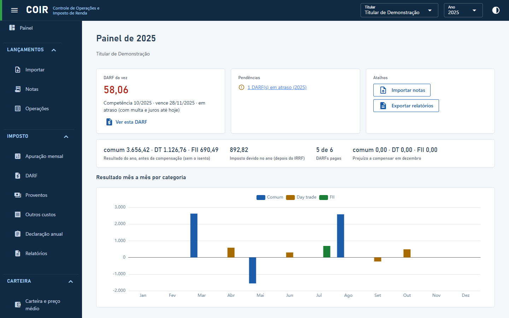

# COIR — Controle de Operações e Imposto de Renda da bolsa

Programa gratuito para Windows que lê as suas **notas de corretagem** e as **planilhas da Área do
Investidor da B3**, calcula o **preço médio**, apura o **imposto de renda mensal** de renda variável,
mostra a **DARF** a pagar e prepara as **fichas da declaração anual** (IRPF).

**Seus dados ficam com você.** O COIR roda só no seu computador. Notas, planilhas e o banco ficam
numa pasta sua; nada da sua carteira é enviado para lugar nenhum.



## Baixar e abrir

1. Baixe o `COIR-<versão>-windows.zip` na [página de versões](../../releases/latest).
2. Extraia o `.zip` numa pasta (por exemplo, `Documentos\COIR`).
3. Dê dois cliques em `COIR.exe`. Na primeira vez, o assistente pede a pasta dos seus dados e o
   titular.

Requisitos: Windows 10 ou 11 com o WebView2 (já vem no Windows 11 e no Edge; sem ele, o COIR abre
no navegador). Não é preciso instalar Python, Java nem Excel.

O programa não tem assinatura digital: o Windows pode mostrar o aviso do SmartScreen ("O Windows
protegeu o computador"). Clique em "Mais informações" e "Executar assim mesmo". Para conferir que o
arquivo é o publicado, compare o SHA-256 do `.zip` com o `.sha256` da página de versões
(`certutil -hashfile COIR-<versão>-windows.zip SHA256`).

## O que o COIR faz

- Lê notas SINACOR (Bovespa e BM&F) da Ágora, BTG/Necton, Clear, Rico e XP e confere cada nota ao
  centavo antes de aceitá-la.
- Ações, FII, opções (com exercício e opção que vira pó), termo, futuros, day trade, isenção de
  R$ 20 mil, compensação de prejuízo, IRRF, proventos e eventos corporativos.
- DARF com código, vencimento, multa e juros de mora; registro do pagamento e do comprovante.
- Declaração anual: Bens e Direitos, rendimentos isentos e exclusivos, renda variável mês a mês.
- Relatórios em Excel, CSV e PDF, sem precisar do Excel instalado.

Manual com o primeiro uso e uma página por tela: [`docs/manual/`](docs/manual/README.md). O que muda ao trocar de
versão: [`docs/manual/atualizacao.md`](docs/manual/atualizacao.md). O que ficou para depois da 3.0:
[`docs/roteiro-pos-3.0.md`](docs/roteiro-pos-3.0.md).

A sua corretora não foi lida? Veja [como pedir ou adicionar uma corretora](docs/como-adicionar-corretora.md).

> O COIR ajuda a calcular e a conferir; ele não substitui a orientação de um contador.

## Versão anterior

A v2 (baseada em Excel) está na tag [`v2.1.1`](../../tree/v2.1.1) e em [`legacy/`](legacy/). As
diferenças de cálculo entre a v2 e a v3 estão no [CHANGELOG](CHANGELOG.md).

## Desenvolvimento

Requer [uv](https://docs.astral.sh/uv/) (ele instala o Python 3.13).

```bash
uv sync
uv run pre-commit install
uv run pytest
uv run coir --help
uv run coir ui            # a interface
```

Os dados reais (notas em PDF, planilhas, banco) ficam **fora** do repositório, na pasta indicada
pela variável de ambiente `COIR_DADOS` (ou escolhida no assistente). Nunca versione PDFs, planilhas,
`.db` ou CPFs: o hook do pre-commit e o CI bloqueiam.

- Banco de demonstração (notas fictícias): `uv run python -m tools.banco_demo <pasta>`.
- Capturas de tela do manual: `uv run python -m tools.capturas`.
- Pacote para Windows: `uv run python tools/empacotar.py`.

Regras fiscais: [`docs/regras-fiscais.md`](docs/regras-fiscais.md) e
[`docs/fontes-fiscais.md`](docs/fontes-fiscais.md). Decisões de arquitetura: [`docs/adr/`](docs/adr/).

### Linha de comando

```bash
uv run coir titular adicionar <CPF> --nome "Nome" # titular (as notas também o criam)
uv run coir importar                              # notas em PDF da pasta de dados
uv run coir apurar 2025-03                        # mês com a memória de cálculo
uv run coir carteira 2025-12-31                   # posições e PM fiscal
uv run coir exportar --ano 2025                   # relatórios em xlsx, csv e pdf
```

No pacote para Windows, os mesmos comandos estão em `coir-cli.exe`.

## Licença

A v3 é distribuída sob a **GNU Affero General Public License v3.0 ou posterior** (AGPL-3.0-or-later) —
ver [LICENSE](LICENSE). Em resumo: qualquer pessoa pode usar, estudar, modificar e redistribuir o COIR de
graça; quem distribuir uma versão modificada, ou oferecê-la como serviço pela internet, precisa publicar o
código-fonte dessas modificações sob a mesma licença.

O código da v2 em [`legacy/`](legacy/) continua sob a licença MIT ([legacy/LICENSE](legacy/LICENSE)).
Decisão registrada em [docs/adr/0002-licenca-agpl.md](docs/adr/0002-licenca-agpl.md).
