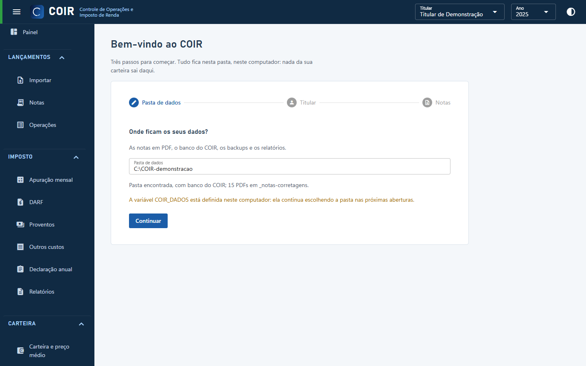

# Primeiro uso

1. **Baixe e extraia** o `COIR-windows.zip` (página de versões do GitHub) numa pasta sua,
   por exemplo `Documentos\COIR`. Dê dois cliques em `COIR.exe`. Se o Windows mostrar o aviso do
   SmartScreen, clique em "Mais informações" e "Executar assim mesmo" (o programa não tem
   assinatura digital; confira o SHA-256 se quiser). Se não abrir, veja
   [Se o COIR não abrir](se-nao-abrir.md).
2. **Pasta de dados**: o assistente pergunta onde ficam os seus dados (banco, backups, relatórios
   e, por padrão, as notas em PDF). Escolha uma pasta fora da pasta do programa, por exemplo
   `Documentos\COIR-dados`. Ela fica registrada em `%APPDATA%\COIR\config.json`.
3. **Titular**: informe CPF e nome de quem é dono das notas. As notas também criam o titular pelo
   CPF impresso.
4. **Notas**: importe os PDFs das notas de corretagem (de preferência todo o histórico, desde a
   primeira compra). Cada nota é conferida ao centavo; as que não fecharem aparecem com o motivo.
5. **Planilhas da B3** (opcional, recomendado): em Importar › Planilhas da B3, a movimentação da
   Área do Investidor traz proventos e eventos; o consolidado mensal permite a conciliação.
6. **Histórico incompleto?** Se as notas começam depois de você já ter ações, informe a custódia
   e os prejuízos em 31/12 do ano anterior em Cadastros › Saldos iniciais.
7. Escolha o **ano** no topo e confira o [Painel](telas/painel.md), a
   [Apuração mensal](telas/apuracao.md) e a [DARF](telas/darf.md).

[Voltar ao índice do manual](README.md)
