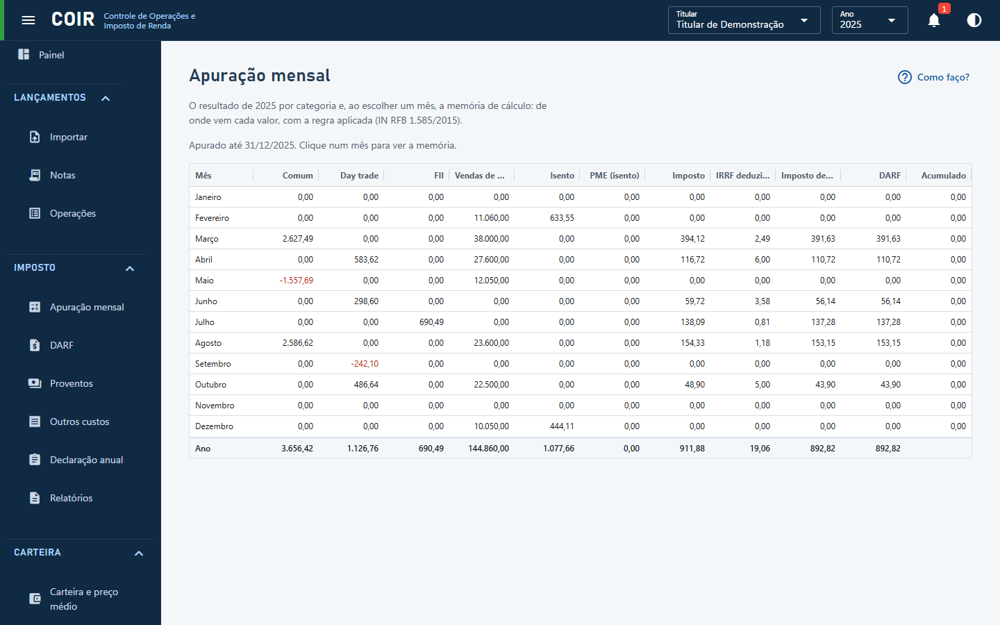

# Apuração mensal

O imposto mês a mês por categoria (comum, day trade, FII): vendas de ações no mês, inclusive em day trade (limite de R$ 20 mil), ganho isento, resultado, prejuízo anterior, base, imposto, IRRF deduzido e DARF. Escolha o mês para ver a **memória de cálculo**: cada movimento com a regra aplicada; clique num movimento para abrir a nota.

No quadro **Limite de isenção**, a soma das vendas de ações do mês aparece com as duas parcelas, operações comuns e day trade, quando há day trade. A venda em day trade entra na soma (critério do COIR, leitura literal da Lei 11.033/2004 art. 3º I), mas o ganho dela nunca é isento: dentro do limite, só o ganho das vendas comuns de ações é isento. Num mês em que só o day trade leva a soma acima de R$ 20 mil, a apuração avisa. Vendas de ações de pequena ou média empresa (PME) aparecem em linhas próprias: o ganho é isento e fica fora do limite, e a perda não compensa outros ganhos.

Abaixo dos movimentos, **Resultado por ativo** junta o mês por dia e ativo (custo médio, preço final, lucratividade e resultado); clique numa linha para ver só os movimentos dela.

[Voltar ao índice do manual](../README.md)
