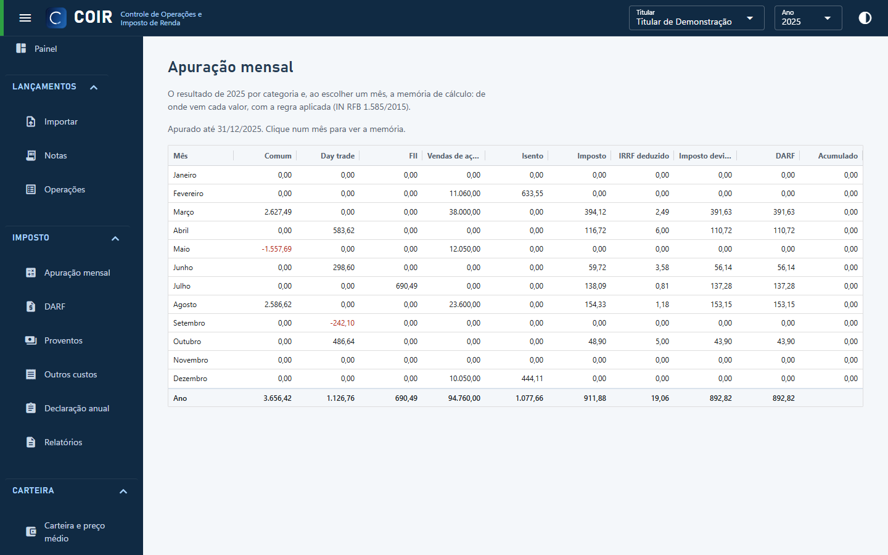

# Apuração mensal

O imposto mês a mês por categoria (comum, day trade, FII): vendas de ações no mês (limite de R$ 20 mil), ganho isento, resultado, prejuízo anterior, base, imposto, IRRF deduzido e DARF. Escolha o mês para ver a **memória de cálculo**: cada movimento com a regra aplicada; clique num movimento para abrir a nota.

[Voltar ao índice do manual](../README.md)
