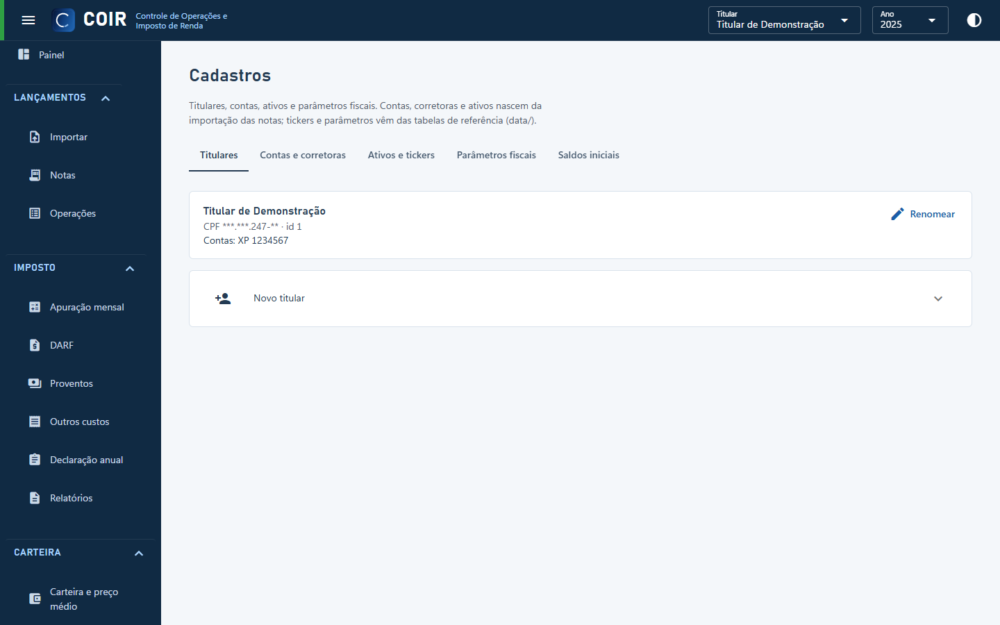

# Cadastros

Abas: **Titulares**, **Contas e corretoras**, **Ativos e tickers** (nomes de pregão e trocas de ticker), **Parâmetros fiscais** (alíquotas, limites e critérios, cada um com a fonte legal; os que admitem escolha podem ser mudados) e **Saldos iniciais** (custódia em 31/12 e prejuízos a compensar por categoria, para quem começa o histórico das notas depois de já ter ações).

[Voltar ao índice do manual](../README.md)
