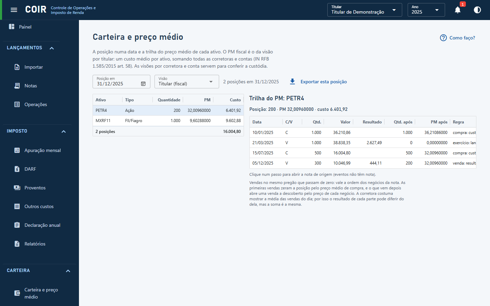

# Carteira e preço médio

A posição numa data, com quantidade, preço médio e custo. A visão **Titular (fiscal)** é a que vale para o IR (um custo médio por ativo, somando corretoras e contas; IN RFB 1.585/2015 art. 58); as visões por corretora e conta servem para conferir a custódia. Escolha um ativo para ver a **trilha do preço médio** (cada compra, venda e evento). Exportar esta posição grava a planilha.

**Vendas no mesmo pregão que passam de zero:** quando você vende, no mesmo dia, mais do que tinha, vale a ordem dos negócios da nota. As primeiras vendas zeram a posição, com resultado pelo preço médio de compra; o que vem depois abre uma venda a descoberto pelo preço de cada negócio, e o resultado dessa parte sai na recompra. A corretora costuma mostrar o preço médio das vendas do dia, que é só uma forma de exibir: o resultado de cada parte pode ficar diferente do dela, mas a soma das duas é a mesma. Exemplo: 3.000 ações a 7,50; venda de 3.000 a 8,10 e depois de mais 3.000 a 8,20; recompra de 3.000 a 8,00. No COIR, a primeira venda dá 1.800,00 e a segunda, 600,00 na recompra. Pela média do dia (8,15) seriam 1.950,00 e 450,00. Nos dois casos, 2.400,00.

Uma **compra a termo ainda não liquidada** aparece numa linha própria, logo abaixo do ativo, com a data da liquidação. Ela não entra na posição, no preço médio nem no total até liquidar, como na B3; ao clicar, o painel mostra a nota da compra.

[Voltar ao índice do manual](../README.md)
