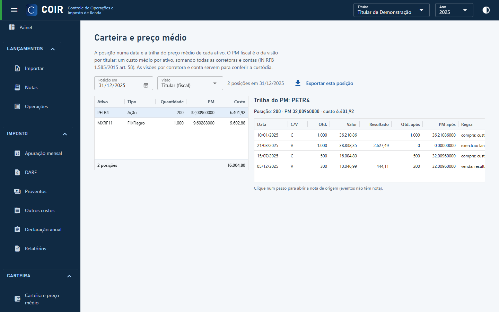

# Carteira e preço médio

A posição numa data, com quantidade, preço médio e custo. A visão **Titular (fiscal)** é a que vale para o IR (um custo médio por ativo, somando corretoras e contas; IN RFB 1.585/2015 art. 58); as visões por corretora e conta servem para conferir a custódia. Escolha um ativo para ver a **trilha do preço médio** (cada compra, venda e evento). Exportar esta posição grava a planilha.

[Voltar ao índice do manual](../README.md)
