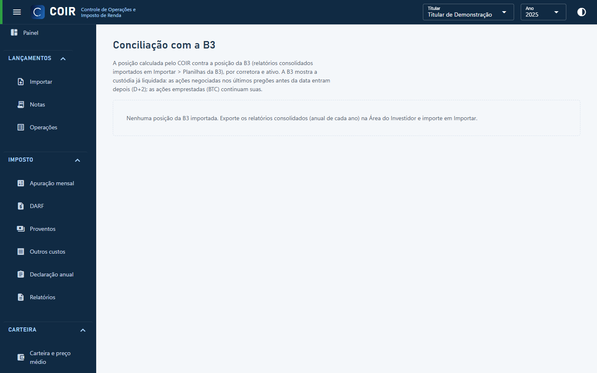

# Conciliação com a B3

Compara a custódia calculada pelo COIR com a posição da B3 (planilhas de posição ou consolidado mensal importadas) numa data, ativo a ativo, e explica as diferenças (só na B3, só no COIR, quantidade diferente).

[Voltar ao índice do manual](../README.md)
