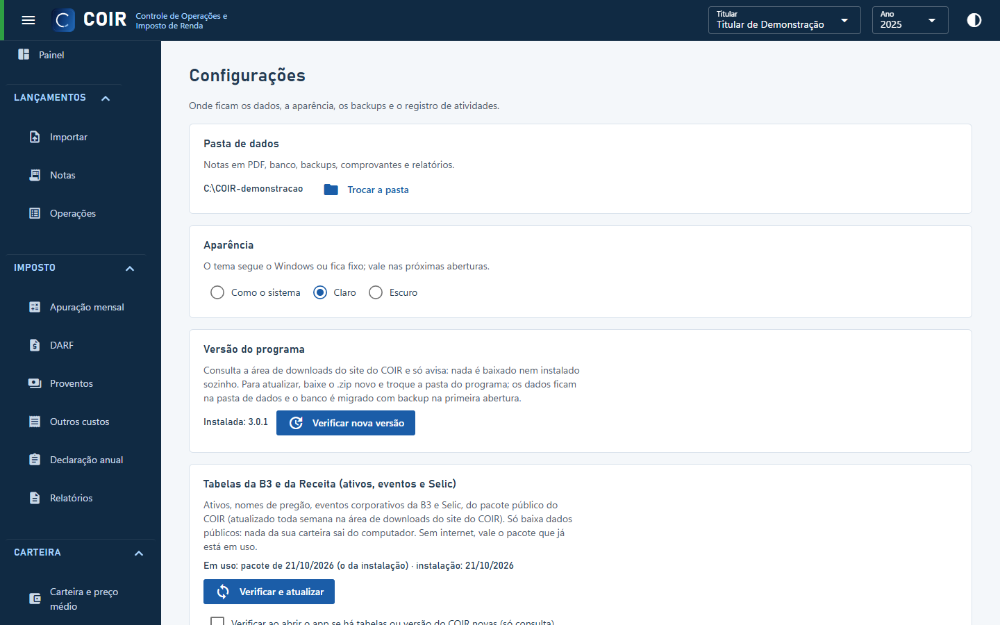

# Configurações

Pasta de dados, aparência (tema do Windows, claro ou escuro), **backups** (fazer agora, restaurar), **tabelas de referência** (versão em uso e o botão Atualizar tabelas), **versão do programa** (Verificar nova versão; a opção de verificar ao abrir vale para tabelas e programa) e o **registro de atividades** (importações, backups, migrações e erros, com filtro e botão para abrir a pasta).

Para enviar uma nota que o COIR não lê, veja a tela [Suporte](suporte.md).

[Voltar ao índice do manual](../README.md)
