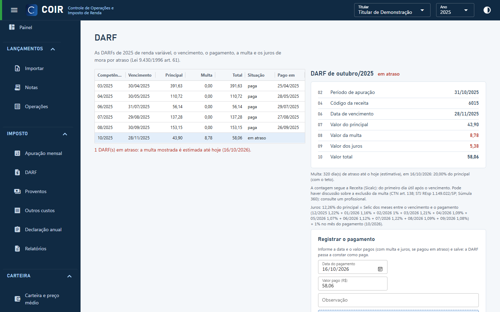

# DARF

As DARFs do ano (código 6015) com vencimento (último dia útil do mês seguinte), principal, multa, total e situação (a pagar, em atraso, paga, acumulada abaixo de R$ 10, em apuração). Ao escolher uma, os campos aparecem como no DARF (período, código, vencimento, principal, multa, juros, total), com a explicação da multa e dos juros de mora (Lei 9.430/1996 art. 61, contagem como o Sicalc). Em **Registrar o pagamento** informe data e valor pagos e, se quiser, anexe o comprovante (PDF).

[Voltar ao índice do manual](../README.md)
