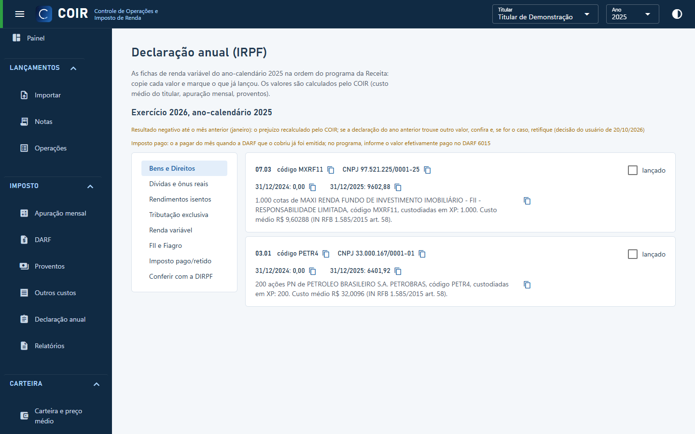

# Declaração anual

As fichas de renda variável do ano na ordem do programa da Receita: **Bens e Direitos** (um item por ativo, com código, CNPJ, situação em 31/12 dos dois anos e discriminação pronta), Dívidas e ônus reais (posição vendida), Rendimentos isentos, Tributação exclusiva, Renda variável (mês a mês, comuns/day trade e FII) e Imposto pago. Cada valor tem botão de copiar; marque **lançado** para acompanhar o que já passou para o programa. **Conferir com a DIRPF** lê o PDF da declaração entregue e aponta as diferenças.

[Voltar ao índice do manual](../README.md)
