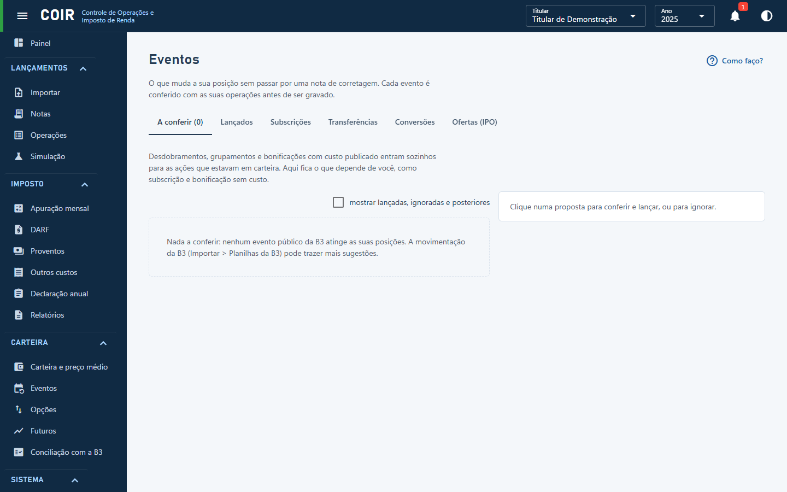

# Eventos

O que muda a sua posição sem passar por uma nota de corretagem. Cada evento é conferido com as suas operações antes de ser gravado: se não fechar, ele não entra e a tela diz por quê.

## A conferir

O que a B3 mostra e ainda não está no seu histórico, vindo das tabelas públicas da B3 e da movimentação importada.

Desdobramentos, grupamentos e bonificações com custo publicado pela companhia na CVM **entram sozinhos** para as ações que estavam em carteira na data, ao importar notas e ao abrir esta tela. A tela mostra quantos entraram, com **Desfazer**; o que você apagar não volta. Eventos depois da sua última nota ficam de fora até você importar as notas seguintes, porque o COIR não sabe se você ainda tinha o ativo.

No alto da aba podem aparecer avisos:

- **Movimentação da B3 ausente ou incompleta:** sem a planilha de movimentação do período das notas, subscrições, restituições e ofertas não aparecem. Importe-a em Importar › Planilhas da B3.
- **Bonificação sem custo atribuído:** já lançada, mas sem o custo, o preço médio da venda sai errado. **Corrigir** abre o evento na aba Lançados.
- **Ativo que parou de negociar:** posição em ativo sem negócio na bolsa há mais de 90 dias, com o que houve, quando se sabe (falta um evento?). **Ignorar** tira o aviso daqui e do sino.

Entre as propostas também vêm a **restituição de capital** em dinheiro (proposta como redução de capital, só com o valor) e o **direito não exercido**: o direito, recibo ou bônus de subscrição comprado que venceu sem ser exercido nem vendido vira perda em operações comuns na data do fim do prazo de subscrição. A caixa **mostrar lançadas, ignoradas e posteriores** mostra o resto da lista.

Aqui fica o que depende de você:

- **Uma a uma:** clique numa proposta, confira os campos e use **Gravar**, ou **Ignorar proposta** se ela não vale para você. A movimentação da B3 traz a data do crédito; troque pela data ex (primeiro pregão sem o direito).
- **De uma vez:** **Lançar as seguras** só aparece se algum lançamento automático não tiver entrado, com o motivo na tela.

Ficam de fora das seguras o que pede algo seu (bonificação sem custo publicado, subscrição, cisão, incorporação), os ajustes de séries de opção, o evento que entrega outra classe da ação, e o grupamento muito forte, que costuma vir seguido de desdobramento no mesmo dia.

## Lançados

Todos os eventos do titular. Clique num deles para corrigir ou excluir. Aqui também entram os que não têm aba própria: desdobramento, grupamento, bonificação, redução de capital, leilão de fração e direito não exercido.

## Subscrições

Direitos de subscrição que você recebeu e ações novas que comprou com eles. São três lançamentos, e a movimentação da B3 propõe cada um na aba **A conferir**:

- **Direito de subscrição recebido:** os direitos que a companhia ou o fundo creditou para você, sem custo, na data do crédito. O direito comprado em bolsa não é lançado aqui: ele já vem na nota de corretagem.
- **Subscrição com direito (exercício):** você usou os direitos para subscrever. Informe os direitos usados, o recibo recebido e o **valor pago** (a B3 não informa esse valor: é a quantidade vezes o preço de subscrição). O custo dos direitos comprados soma ao valor pago, e o exercício não gera imposto.
- **Recibo que virou ação:** quando as ações são creditadas, o recibo vira ação com o mesmo custo. Esse lançamento fica na aba **Conversões**. Até lá, as ações novas não entram no preço médio das antigas, e o recibo vendido antes é tributado como direito (15%, sem isenção).

A opção **Subscrição** simples (ações subscritas e valor pago, direto na ação) continua valendo para quem não tem o direito nem o recibo na movimentação.

Se você vender um direito recebido sem ter lançado o crédito, o COIR o considera com custo zero na própria venda. Quando também há direitos comprados, ele avisa: sem a data do crédito, o custo médio dos direitos sai errado.

## Transferências

Ativos que você levou de uma corretora para outra. Informe a data, a origem, o destino e o ativo. Deixe a quantidade vazia para mover toda a posição. Não muda o preço médio nem gera imposto.

## Conversões

Quando um ativo vira outro: conversão de classe, incorporação, fusão, cisão ou ajuste de série de opção. Informe o ativo e a quantidade que saem e o ativo e a quantidade que entram. Na cisão, informe também o percentual do custo que está no aviso aos acionistas.

## Ofertas (IPO)

Compras em IPO ou follow-on, que não aparecem em nota de corretagem. Informe a data da liquidação, a conta, o ativo, as ações compradas e o valor pago. A compra entra no preço médio como qualquer outra. Se você vendeu nos dias antes da liquidação, a compra entra no dia da venda, e o ganho fica no mês da venda. Ações de pequena ou média empresa (PME) da lista da B3 têm a isenção considerada.

[Voltar ao índice do manual](../README.md)
