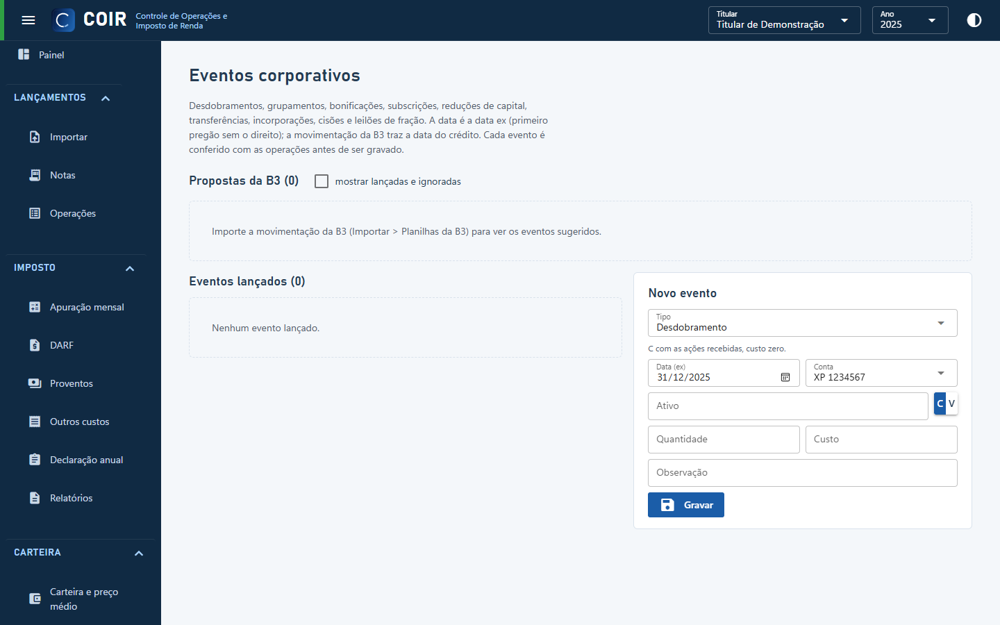

# Eventos

Eventos corporativos (desdobramento, grupamento, bonificação, incorporação, cisão, troca de ticker, leilão de fração) aplicados à carteira. O COIR **propõe** os eventos a partir das tabelas públicas da B3 e da movimentação importada; clique numa proposta para conferir e lançar, ou ignorar. Os lançados podem ser corrigidos ou excluídos.

[Voltar ao índice do manual](../README.md)
