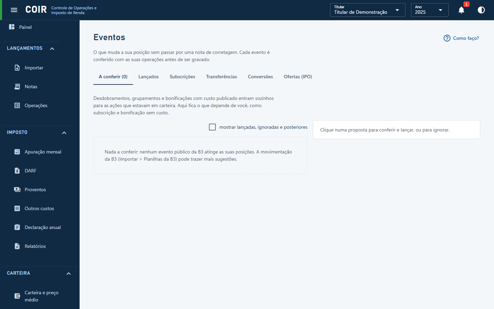

# Eventos

O que muda a sua posição sem passar por uma nota de corretagem. Cada evento é conferido com as suas operações antes de ser gravado: se não fechar, ele não entra e a tela diz por quê.

## A conferir

O que a B3 mostra e ainda não está no seu histórico, vindo das tabelas públicas da B3 e da movimentação importada.

- **Uma a uma:** clique numa proposta, confira os campos e use **Gravar**, ou **Ignorar proposta** se ela não vale para você. A movimentação da B3 traz a data do crédito; troque pela data ex (primeiro pregão sem o direito).
- **De uma vez:** **Lançar as seguras** lança os desdobramentos e os grupamentos das tabelas da B3, que já vêm com a data ex e a quantidade, e as bonificações com o custo publicado pela companhia na CVM. Antes, a tela mostra a lista para você conferir, com o custo por ação e a fonte. Depois, **Desfazer** tira todos de uma vez enquanto você estiver nesta tela; se sair, exclua um a um em **Lançados**. Se o mesmo ativo tiver mais de um evento, entra o mais antigo, e o botão volta a aparecer com o seguinte, já com a quantidade certa.

Ficam de fora das seguras o que pede algo seu (bonificação sem custo publicado, subscrição, cisão, incorporação), os ajustes de séries de opção, o evento que entrega outra classe da ação, e o grupamento muito forte, que costuma vir seguido de desdobramento no mesmo dia.

## Lançados

Todos os eventos do titular. Clique num deles para corrigir ou excluir. Aqui também entram os que não têm aba própria: desdobramento, grupamento, bonificação, redução de capital e leilão de fração.

## Subscrições

Ações novas que você decidiu comprar pelo direito de acionista. Informe a data, a conta, o ativo, as ações subscritas e o valor pago.

## Transferências

Ativos que você levou de uma corretora para outra. Informe a data, a origem, o destino e o ativo. Deixe a quantidade vazia para mover toda a posição. Não muda o preço médio nem gera imposto.

## Conversões

Quando um ativo vira outro: conversão de classe, incorporação, fusão, cisão ou ajuste de série de opção. Informe o ativo e a quantidade que saem e o ativo e a quantidade que entram. Na cisão, informe também o percentual do custo que está no aviso aos acionistas.

## Ofertas (IPO)

Compras em IPO ou follow-on, que não aparecem em nota de corretagem. Informe a data da liquidação, a conta, o ativo, as ações compradas e o valor pago. A compra entra no preço médio como qualquer outra. Se você vendeu nos dias antes da liquidação, a compra entra no dia da venda, e o ganho fica no mês da venda. Ações de pequena ou média empresa (PME) da lista da B3 têm a isenção considerada.

[Voltar ao índice do manual](../README.md)
