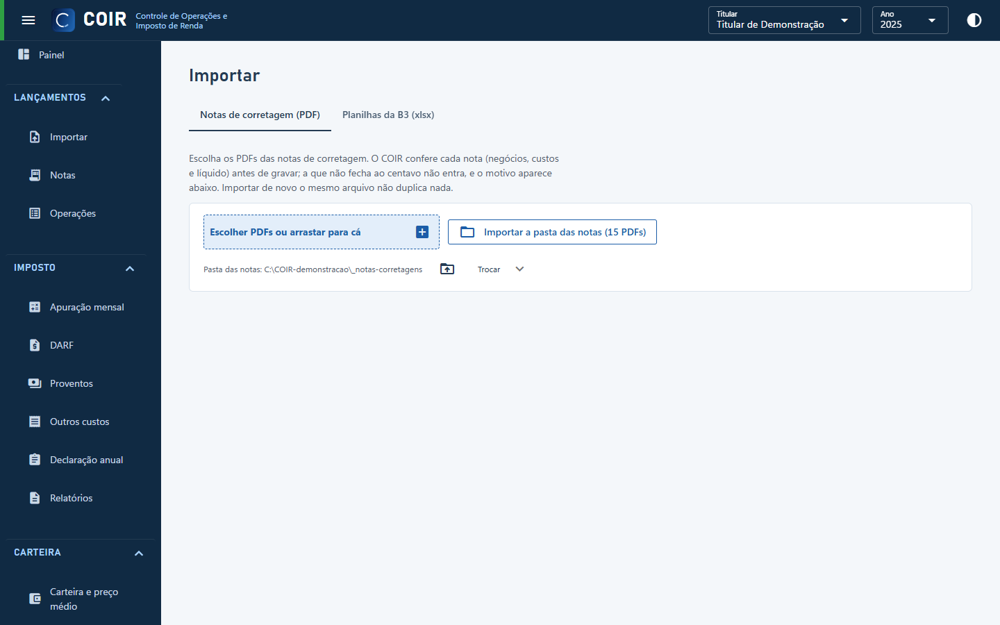

# Importar

Duas abas:

- **Notas de corretagem (PDF)**: escolha os PDFs (ou arraste) ou importe a pasta das notas inteira. Cada nota é conferida ao centavo (negócios, custos e líquido) antes de ser gravada; a que não fecha não entra e o motivo aparece na lista. Importar o mesmo arquivo de novo não duplica nada. Um PDF pode ter várias notas e várias folhas.
- **Planilhas da B3 (xlsx)**: as planilhas da Área do Investidor (movimentação, negociação, posição/consolidado mensal). A movimentação traz os proventos e os eventos; o consolidado serve à conciliação com a B3.

O titular sai do CPF impresso na nota; se ele não existir, é criado (confira o nome em Cadastros).

[Voltar ao índice do manual](../README.md)
