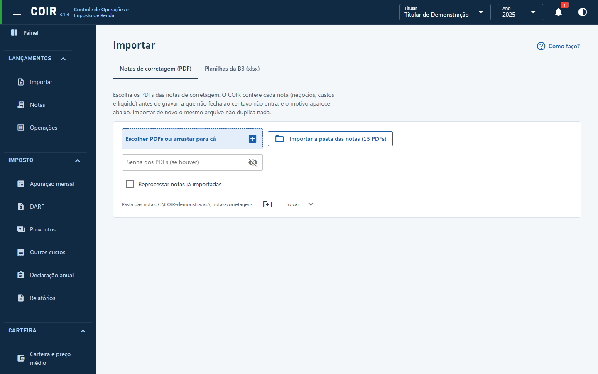

# Importar

Duas abas:

- **Notas de corretagem (PDF)**: escolha os PDFs (ou arraste) ou importe a pasta das notas inteira. Cada nota é conferida, com os centavos de arredondamento na linha "Ajuste de arredondamento" (negócios, custos e líquido) antes de ser gravada; a que não fecha não entra e o motivo aparece na lista. Importar o mesmo arquivo de novo não duplica nada. Um PDF pode ter várias notas e várias folhas.
- **Reprocessar notas já importadas**: marque antes de escolher os PDFs ou a pasta para o COIR ler tudo de novo e ficar com a releitura. Serve quando ele leu algo errado ou quando a corretora corrigiu a nota. O banco ganha um backup antes; a nota que mudou é trocada, o registro antigo de uma nota lida com outra conta, número ou data é removido, e a nota que a releitura não confirma (página recusada ou pulada) continua como está. A versão anterior fica guardada e pode ser vista na tela Notas. Depois, confira a apuração do mês citado na lista. Uma nota alterada pode mudar também os meses seguintes, pelo preço médio e pelo prejuízo: se houver DARF paga desse mês em diante, a lista avisa, e a tela DARF mostra a diferença em cada mês.
- **PDF com senha** (notas enviadas por e-mail): o COIR tenta sozinho o começo do CPF dos titulares já cadastrados. Na primeira importação, ou se a senha for outra, digite-a no campo **Senha dos PDFs** antes de escolher os arquivos; ela vale para todo o lote e fica só na memória até fechar o programa (nunca é gravada). Pela linha de comando: `coir importar --senha 123`.
- **Planilhas da B3 (xlsx)**: as planilhas da Área do Investidor (movimentação, negociação, posição/consolidado mensal). A movimentação traz os proventos e os eventos; o consolidado serve à conciliação com a B3.

O titular sai do CPF impresso na nota; se ele não existir, é criado (confira o nome em Cadastros).

**Corretora que o COIR ainda não conhece:** ele tenta ler a nota pelos layouts padrão. Se os totais fecharem, a nota entra com um aviso para você conferir as operações (se algo estiver errado, mande a nota pela tela [Suporte](suporte.md)); se não fecharem, ela é recusada com o motivo, e nada dela é gravado.

**Nome de pregão que vale para dois códigos:** a nota traz o nome do ativo, não o código, e às vezes o mesmo nome valia para dois códigos na data (dois BDR da mesma companhia, por exemplo). O COIR não escolhe no palpite. Se a planilha de negociação da B3 do período já estiver importada, ele acha o código pelo negócio (mesmo dia, compra ou venda, quantidade e preço). Se não, a nota é recusada e a tela pergunta **Qual é o código do ativo?**: confira no extrato da corretora ou na Área do Investidor, marque o código e clique em **Gravar a escolha e importar de novo**. A escolha fica guardada para as notas dessa conta naquele pregão (os dois códigos podem ter sido negociados em dias diferentes, por isso a pergunta vem uma vez por dia). Nota já gravada fica com o código com que entrou; se mais tarde a planilha da B3 mostrar outro código, vale a planilha.

Depois de importar notas, os desdobramentos, grupamentos e bonificações com custo publicado das ações em carteira entram sozinhos, e um aviso diz quantos; veja a tela [Eventos](eventos.md).

[Voltar ao índice do manual](../README.md)
