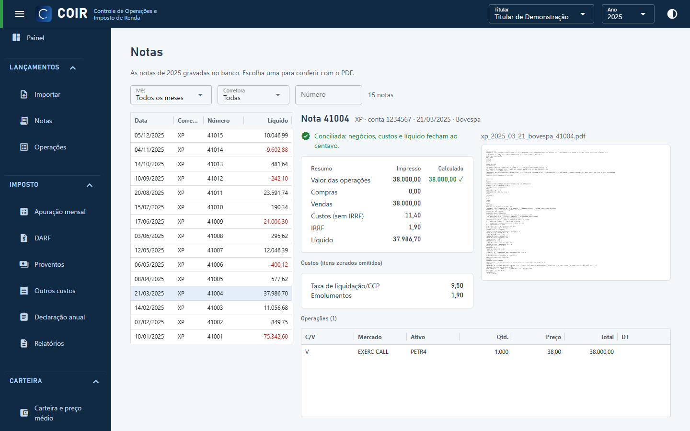

# Notas

Lista das notas do ano com filtros por mês, corretora e número. Ao escolher uma nota, o COIR mostra o resumo impresso ao lado do calculado (com a marca de conciliada), os custos, as operações lidas e o PDF original, que pode ser ampliado.

[Voltar ao índice do manual](../README.md)
