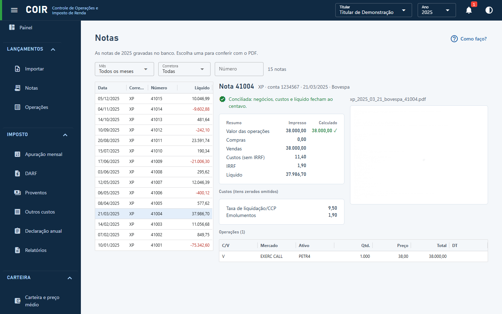

# Notas

Lista das notas do ano com filtros por mês, corretora e número. Ao escolher uma nota, o COIR mostra o resumo impresso ao lado do calculado (com a marca de conciliada), os custos, as operações lidas e o PDF original, que pode ser ampliado.

Se a nota foi alterada por um reprocessamento, uma linha mostra a data e o que mudou, e o botão **Ver versão anterior** abre o que ela dizia antes.

## Nota manual

Para a nota que se perdeu, ou de corretora que não dá nota em PDF, use **Nova nota manual** no topo da tela. Digite a nota como a corretora a imprimiria:

- **Cabeçalho:** a conta (ou **Conta nova...**, com a corretora e o número da conta), a data do pregão, o número da nota e o segmento (Bovespa ou BM&F).
- **Operações:** uma linha para cada negócio.
  - Na Bovespa: compra ou venda, mercado, código do ativo, vencimento da opção (MM/AA) ou prazo do termo em dias, quantidade, preço e a marca de day trade.
  - Na BM&F: contrato, vencimento, tipo (NORMAL, DAY TRADE ou AJUPOS), quantidade, preço e o valor da linha, com D ou C.
- **Custos e IRRF**, como estão na nota ou no extrato da corretora. Em branco vale zero.

**Conferir totais** mostra o valor das operações, os custos e o líquido. **Gravar** confere a nota do mesmo jeito que as lidas do PDF e faz um backup antes. A nota entra no cálculo com as mesmas regras: day trade, rateio dos custos, IRRF e preço médio. Se a nota deixar alguma operação sem fechar, por exemplo uma venda de ativo que não está na carteira, nada é gravado e o motivo aparece na tela.

Sem número informado, o COIR sugere M1, M2... No mesmo pregão, os negócios de uma nota com letra no número contam depois dos negócios das notas numeradas. Código de ativo que as tabelas não conhecem entra com aviso: confira se foi digitado certo.

Na lista, a nota manual aparece com "(manual)". No detalhe, **Corrigir** abre o formulário preenchido e **Remover** a tira do cálculo, depois de pedir confirmação. Nos dois casos, o COIR faz backup e guarda a versão anterior.

Se achar o PDF dessa nota depois, importe-o e remova a nota manual. Enquanto as duas estiverem gravadas, as operações contam duas vezes; o COIR avisa na importação e no sino do topo.

[Voltar ao índice do manual](../README.md)
