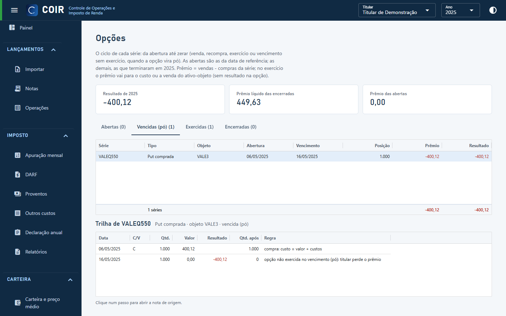

# Opções

O ciclo de cada série de opção, da abertura até zerar: abertas, vencidas (pó), exercidas e encerradas. No exercício o prêmio vai para o custo ou a venda do ativo-objeto (sem resultado na opção); a opção não exercida dá resultado no vencimento. Escolha uma série para ver a trilha do ciclo; clique num passo para abrir a nota.

[Voltar ao índice do manual](../README.md)
