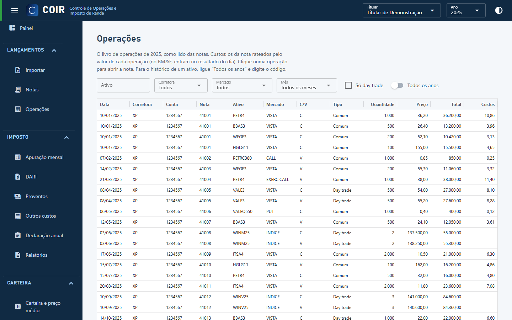

# Operações

O livro de operações (uma linha por negócio, já com ticker, mercado, categoria e custos rateados), com filtros e exportação. Clique numa linha para abrir a nota de origem.

[Voltar ao índice do manual](../README.md)
