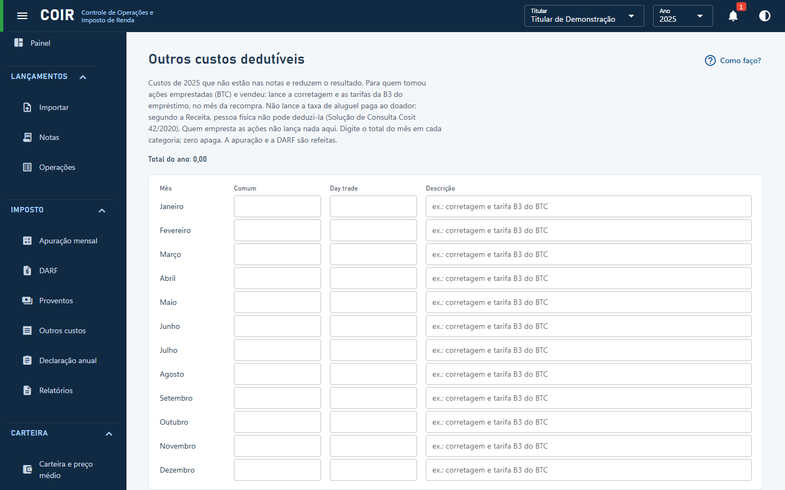

# Outros custos

Custos dedutíveis que não estão nas notas. O caso comum é o de quem tomou ações emprestadas (BTC) e vendeu: a corretagem e as tarifas da B3 do empréstimo entram no mês da recompra. Se não houve recompra, entram no mês em que o empréstimo foi liquidado.

Segundo a Receita, a remuneração paga ao doador não é dedutível para pessoa física (Solução de Consulta Cosit 42/2020); a dedução vale só para empresa no lucro real. Os custos da venda e da recompra já vêm nas notas: não lance de novo. O doador não lança nada aqui, porque o imposto sobre a remuneração é retido na fonte e é definitivo.

Em mês de ganho isento, o custo reduz primeiro o ganho isento, e só o que sobrar reduz o resultado.

A Lei 15.265/2025, em vigor para o empréstimo desde 2026, não repete a regra expressa sobre corretagens e emolumentos; o COIR mantém a dedução pela regra geral de custos necessários (IN RFB 1.585/2015, art. 56 §3º). Tratar as tarifas da B3 como emolumento é uma interpretação, porque nenhuma norma usa esse termo. Em caso de dúvida, consulte um profissional.

[Voltar ao índice do manual](../README.md)
