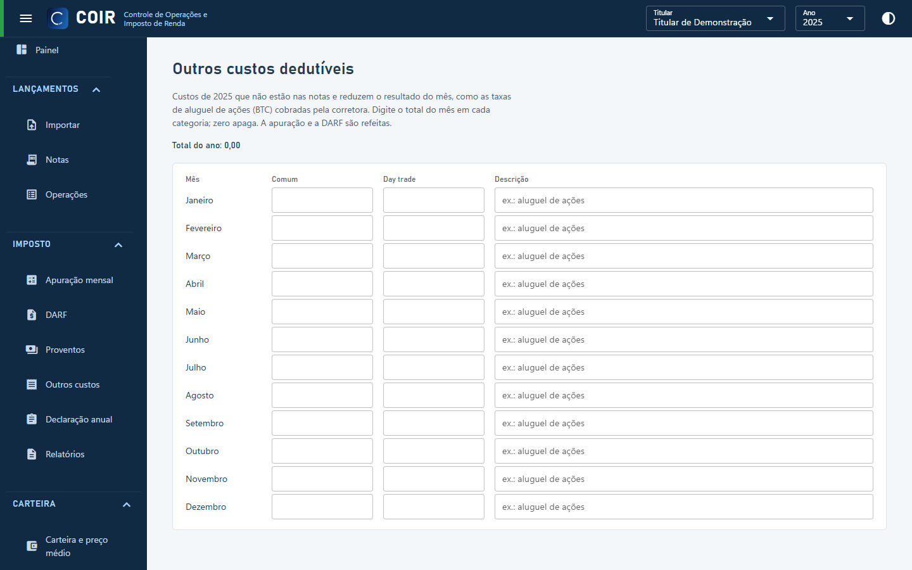

# Outros custos

Custos dedutíveis que não estão nas notas (por exemplo, taxas de aluguel de ações em BTC cobradas à parte). Eles entram na apuração do mês informado.

[Voltar ao índice do manual](../README.md)
