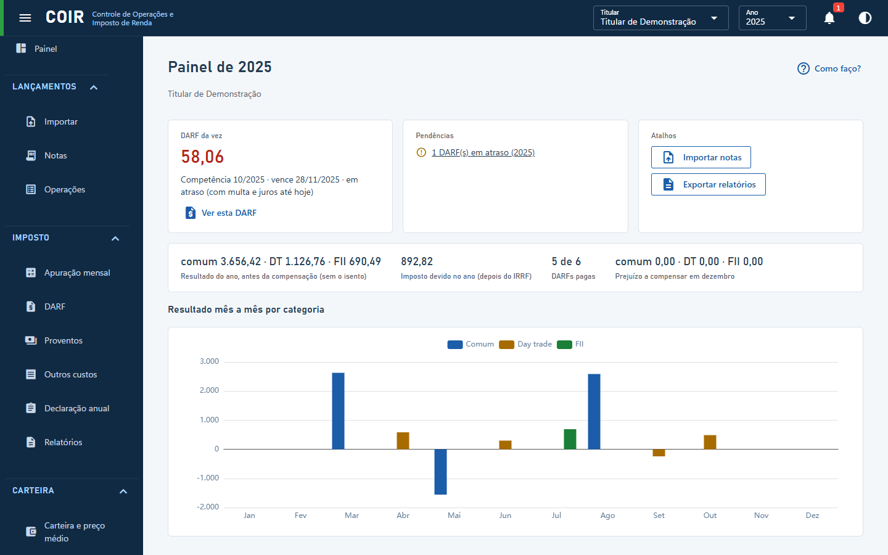

# Painel

Resumo do ano escolhido no topo: a **DARF da vez** (a próxima a pagar ou a mais antiga em atraso, com multa e juros até hoje), as **pendências** de todos os anos (DARFs em atraso, notas rejeitadas, ativos fora do cálculo, propostas de evento para conferir, avisos da apuração; as mesmas do **sino** no topo da janela, que mostra a quantidade em qualquer tela; clicar abre a tela já no ano do item), atalhos para importar e exportar, os totais do ano (resultado por categoria, imposto devido, DARFs pagas, prejuízo a compensar em dezembro) e o gráfico do resultado mês a mês por categoria (comum, day trade, FII). Clique na DARF para abri-la na tela DARF. Quando há versão nova do programa (opção em Configurações), o aviso aparece aqui.

[Voltar ao índice do manual](../README.md)
