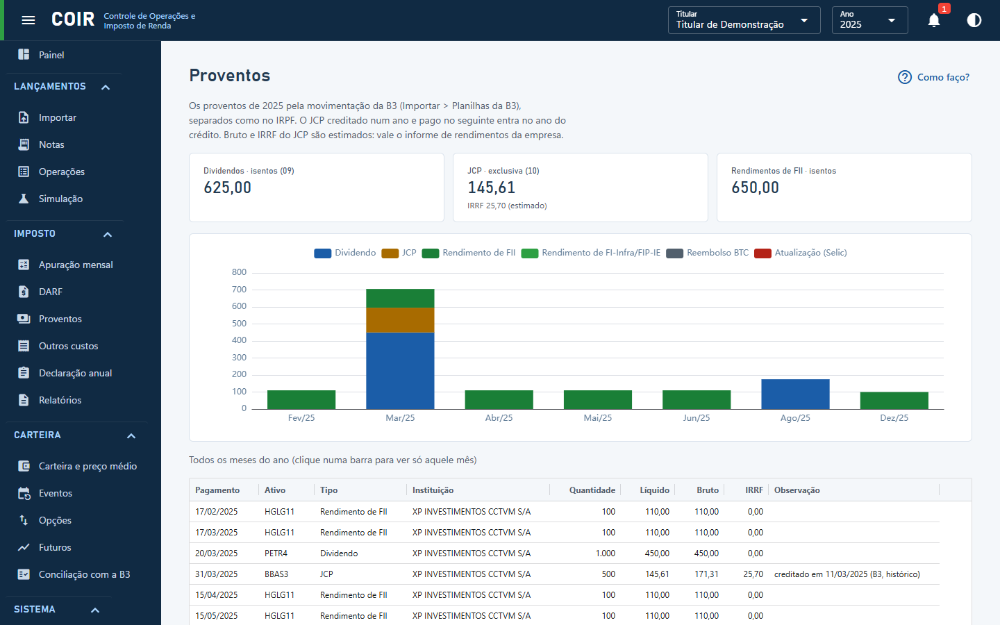

# Proventos

Dividendos, JCP, rendimentos de FII, reembolsos de BTC e atualizações pela Selic, lidos da movimentação da B3 (Importar › Planilhas da B3) e separados como no IRPF (isentos, código 09; tributação exclusiva, código 10). O JCP creditado num ano e pago no seguinte entra no ano do crédito (data com da B3, ou a data que você informar). Reembolsos de BTC sem origem identificada podem ser marcados como dividendo ou JCP.

**Rendimentos de ETF:** o rendimento distribuído por ETF de renda fixa, e por ETF de ações desde 2024, tem imposto retido na fonte e vai para a ficha de tributação exclusiva, código 06, pelo valor líquido que a B3 creditou. O informe do administrador do fundo prevalece. O rendimento de ETF de ações de antes de 2024 fica só listado, com aviso.

**Dividendo de BDR:** não é isento. É rendimento do exterior, e pela leitura literal da lei fica sujeito ao carnê-leão e ao ajuste anual. O COIR lista com aviso e não calcula; confira o informe do banco depositário.

**Dividendo pago em bens:** quando a empresa paga o dividendo com ações ou cotas de outra empresa, lance o evento **Dividendo pago em bens** na tela [Eventos](eventos.md). O valor atribuído aos bens aparece aqui como dividendo isento.

[Voltar ao índice do manual](../README.md)
