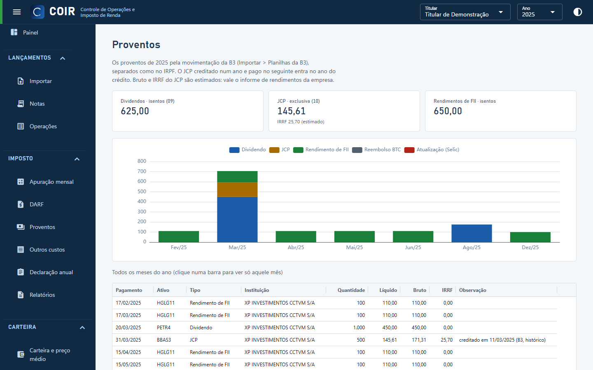

# Proventos

Dividendos, JCP, rendimentos de FII, reembolsos de BTC e atualizações pela Selic, lidos da movimentação da B3 (Importar › Planilhas da B3) e separados como no IRPF (isentos, código 09; tributação exclusiva, código 10). O JCP creditado num ano e pago no seguinte entra no ano do crédito (data com da B3, ou a data que você informar). Reembolsos de BTC sem origem identificada podem ser marcados como dividendo ou JCP.

[Voltar ao índice do manual](../README.md)
