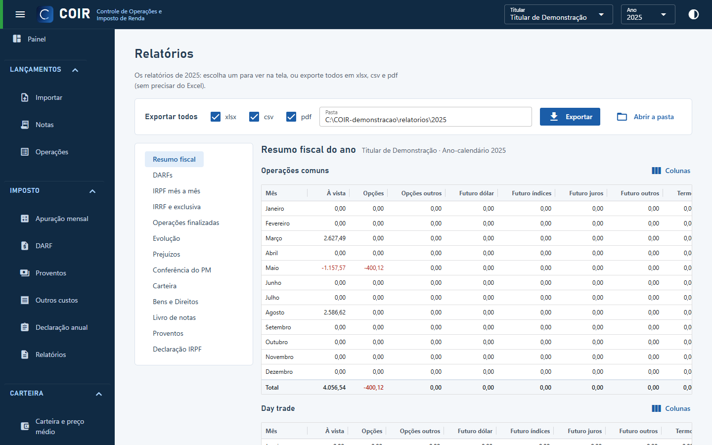

# Relatórios

Os relatórios do ano (resumo fiscal, DARFs, renda variável, IRRF, operações finalizadas, prejuízos, conferência do preço médio, carteira, bens e direitos, livro de notas), na tela e exportados em Excel, CSV e PDF para `COIR_DADOS\relatorios\<ano>`. **Exportar todos** grava todos de uma vez.

[Voltar ao índice do manual](../README.md)
