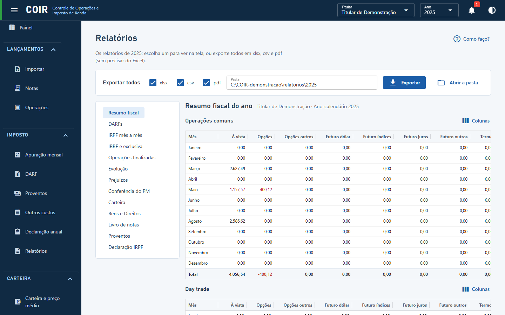

# Relatórios

Os relatórios do ano (resumo fiscal, DARFs, renda variável, IRRF, operações finalizadas, prejuízos, conferência do preço médio, carteira, bens e direitos, livro de notas), na tela e exportados em Excel, CSV e PDF para `COIR_DADOS\relatorios\<ano>`. **Exportar todos** grava todos de uma vez.

[Voltar ao índice do manual](../README.md)

Em **Operações finalizadas**, a vista **Por ativo, mês a mês** traz cada mês com uma linha por dia e ativo (separada por corretora e categoria), para conferir com outro controle; clique numa linha para ver só as operações dela, ou passe para **Operação a operação**. A vista por ativo também vai nos arquivos exportados.
