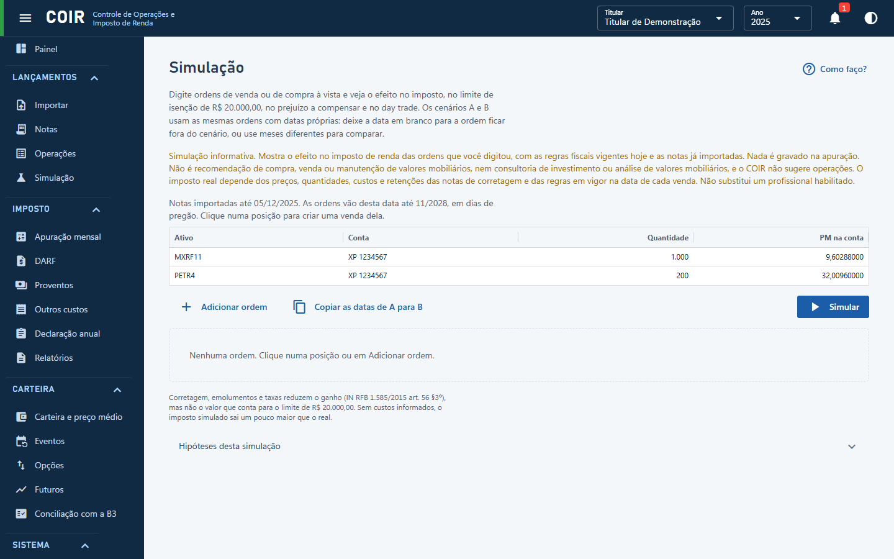

# Simulação

Digite ordens de venda ou de compra à vista e veja o efeito delas no imposto de renda, antes de
operar. O COIR apura as ordens com as mesmas regras da apuração mensal, sobre a carteira das
notas já importadas, e mostra a diferença. **Nada é gravado**: a apuração, a DARF e a carteira não
mudam.

> Simulação informativa. Não é recomendação de compra, venda ou manutenção de valores
> mobiliários, nem consultoria de investimento, e o COIR não sugere operações. O imposto real
> depende dos preços, quantidades, custos e retenções das notas de corretagem e das regras em
> vigor na data de cada venda.

## Como usar

1. Abra **Lançamentos › Simulação** e escolha o titular no topo. A tela mostra até que dia há notas importadas e a carteira de
   cada conta.
2. Clique numa posição para criar uma venda dela, já com o ativo, a conta e a quantidade. Ou use
   **Adicionar ordem** e digite o código do ativo (também para compras).
3. Preencha o preço e, se quiser, os custos da corretora (corretagem, emolumentos e taxas).
   Custos reduzem o ganho, mas não o valor que conta para o limite de R$ 20 mil.
4. Dê a cada ordem uma data no **cenário A** e no **cenário B**:
   - deixe a data em branco para a ordem ficar fora do cenário (por exemplo, só as duas
     primeiras ordens de uma escada executadas);
   - use meses diferentes para comparar vender tudo de uma vez com vender aos poucos.
5. Clique em **Simular**.

As datas vão do dia da última nota importada até o último mês que o calendário de feriados cobre
(a DARF vence no mês seguinte), sempre em dias de pregão.

## O resultado

- **Quadro lado a lado**: sem as ordens, cenário A e cenário B. Imposto e DARF no período, ganho
  isento, prejuízo a compensar no fim de cada categoria, o IRRF que a corretora reteria nas ordens
  (estimativa, não deduzida) e a quantidade e o custo que ficam na carteira. Vender menos dá
  imposto menor agora, mas o ganho continua na carteira.
- **Mês a mês**: soma do limite de isenção, isento, resultado por categoria, imposto, DARF e
  vencimento. Os dois cenários vão até o mesmo mês, porque vender num mês muda o prejuízo e o
  IRRF dos meses seguintes.
- **Ordens**: o resultado de cada ordem, a parte que virou day trade e o preço médio depois dela.
- **Day trade**: quando já há compra (ou venda) do mesmo ativo no mesmo dia e na mesma corretora,
  a parte casada é day trade, com 20%, sem isenção e IRRF de 1%. A simulação supõe a ordem
  executada depois dos negócios já feitos no dia.
- **Avisos** do cálculo que só aparecem com as ordens (por exemplo, quando a soma das vendas do mês
  passa do limite de isenção).

## Regras que a simulação mostra

- O limite de R$ 20.000,00 é do valor bruto de todas as vendas de ações do mês, em todas as
  corretoras e contas do titular (Lei 11.033/2004, art. 3º, I). Passou do limite, o ganho de todas
  as vendas de ações do mês é tributado, inclusive o de vendas que já estavam isentas.
- Units, ETF, BDR, FII, Fiagro e direitos de subscrição não entram na soma e não têm isenção.
- Prejuízo só compensa ganho da mesma categoria (operações comuns, day trade, FII e Fiagro), e o
  ganho isento não consome prejuízo.
- Imposto abaixo de R$ 10,00 não gera DARF: soma-se ao dos meses seguintes (Lei 9.430/1996,
  art. 68).
- As ordens não têm IRRF deduzido: o valor estimado aparece à parte. A DARF real tende a ficar
  um pouco menor.

## O que fica fora

Opções, futuros, ETF de renda fixa, fundos de alíquota zero e FIDC; venda acima da posição da conta
(venda a descoberto); ativo sem tipo nas tabelas ou com pendência na tela Eventos. A tela não
busca cotações, não envia ordens e não sugere preço, quantidade nem data.

As hipóteses completas ficam em **Hipóteses desta simulação**, no fim da tela: preço e quantidade
digitados, preço médio das notas importadas até agora (compras e eventos futuros mudam esse valor) e
regras vigentes hoje (lei nova pode mudar meses futuros).

[Voltar ao índice do manual](../README.md)
