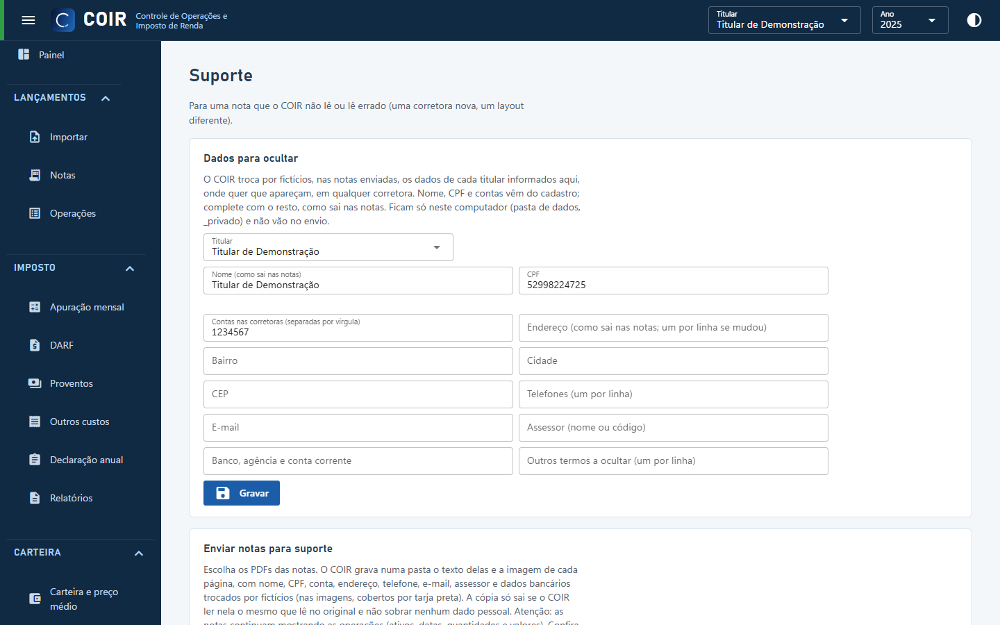

# Suporte

Para uma nota que o COIR não lê, ou lê errado: de uma corretora que ele ainda não conhece, ou de
um layout diferente. Você manda a nota **sem os seus dados pessoais**, e quem desenvolve o COIR
ajusta a leitura.

## Dados para ocultar

Escolha o titular. Nome, CPF e contas vêm do cadastro. Complete com o que sai nas suas notas:
endereço, bairro, cidade, CEP, telefones, e-mail, assessor, banco/agência/conta corrente e
outros termos. Se mudou de endereço ou de telefone, ponha um por linha: as notas antigas
mostram os dados antigos.

O COIR procura esses dados em qualquer lugar da nota, em qualquer corretora: com ou sem acento,
maiúsculas ou minúsculas, com as palavras coladas (como em notas antigas) e números com ou sem
pontos e traços. Nome, CPF, contas, e-mail e números longos são trocados onde aparecerem. Uma
palavra solta do endereço (o bairro "Vale", por exemplo) só é trocada nas linhas que já têm
outro dado seu, porque a mesma palavra pode ser de outra coisa (a ação VALE ON).

Para quem tem vários titulares (um contador, por exemplo), cada um tem os seus dados. O COIR
sabe de quem é cada nota pelo CPF impresso nela, e procura os dados de todos os titulares em
todas as notas.

Esses dados ficam **só no seu computador**, na pasta de dados (`_privado`), e não vão no envio.

## Enviar notas para suporte

Escolha os PDFs das notas. O COIR grava, numa pasta nova dentro de `suporte` (na pasta de
dados), para cada nota:

- o **texto** que o COIR lê dela, com os dados pessoais trocados por fictícios do mesmo tamanho,
  no mesmo lugar (`nota-01.txt`);
- a **imagem** de cada página, com tarja preta sobre o que foi trocado (`nota-01-pagina-1.png`).

Os arquivos levam nomes neutros, porque o nome do PDF pode ter o seu nome. Os PDFs não são
guardados.

Uma nota só fica pronta se passar nas conferências:

- o COIR lê na cópia exatamente o que lê no original;
- nenhum dado pessoal do original sobra na cópia, e nenhum nome, CPF, conta ou e-mail que você
  informou;
- numa corretora que o COIR não conhece, o CPF impresso tem de ter dados para ocultar
  cadastrados, e o nome informado tem de aparecer na nota. Sem isso o COIR não sabe onde estão os
  seus dados e recusa a nota.

A lista mostra, para cada nota, de quem ela é, quantas páginas e quantos trechos foram
ocultados, ou por que foi recusada. **Ver** abre as imagens; **Abrir a pasta** mostra todas no
visualizador do Windows. Um contorno laranja marca um dado seu que ficou à mostra (como a palavra
"Vale" na ação): confira se é mesmo de outra coisa.

**Atenção:** mesmo sem os seus dados, as notas continuam mostrando as operações (ativos, datas,
quantidades e valores).

Depois de conferir, marque **Conferi as imagens** e clique em **Gravar o .zip**. **Escrever
e-mail** abre o seu programa de e-mail com uma mensagem para `suporte.coir@gmail.com`. Anexe o
`.zip`, descreva o problema e envie. Nada sai do seu computador sem essa ação sua.

Pela linha de comando: `coir notas anonimizar <PDFs ou pastas> [--imagens]`.

[Voltar ao índice do manual](../README.md)
